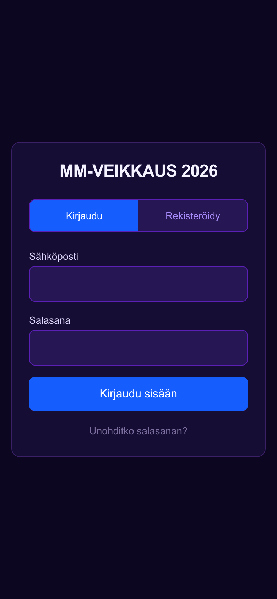
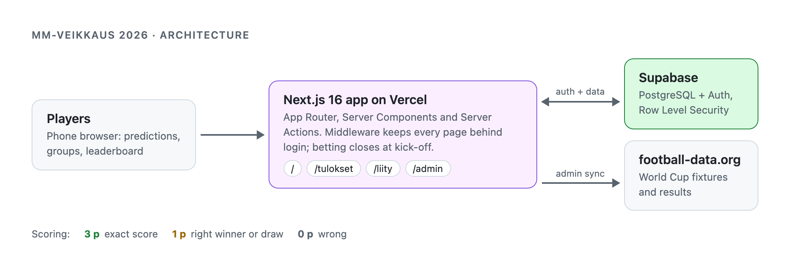

# MM-Veikkaus 2026

**A World Cup 2026 prediction game for groups of friends and colleagues.** Players predict the score of every match, earn points for correct predictions and follow their own group's leaderboard. The app is in Finnish (*MM-kisat* = World Cup, *veikkaus* = prediction pool).

<table>
  <tr>
    <td width="260" valign="top"></td>
    <td valign="top">
      <picture>
        <source media="(prefers-color-scheme: dark)" srcset="docs/images/architecture-dark.png">
        
      </picture>
    </td>
  </tr>
</table>

## Background

Office and friend groups often run a prediction pool for a big tournament on a shared spreadsheet. Someone has to collect everyone's guesses before kick-off, type in the results and work out the points after every match, and many people take part in more than one pool.

## Idea

A small web app that does all of this automatically, built mobile-first for checking on a phone during the match day:

- **One account, many groups.** Anyone can register. Joining a group needs an invite code, so the same player can be in the office pool and the friends' pool, and each group has its own leaderboard.
- **Predictions lock at kick-off.** The form closes at the match's start time, both in the UI and on the server.
- **Points are calculated automatically** when results come in: 3 points for the exact score, 1 for the right winner or a draw, 0 otherwise.
- **After kick-off, predictions are revealed** to the rest of the group. Every match shows statistics: how the predictions were distributed before the match, and how many got it right after it.
- **Results come from an API**, with a manual fallback. The admin syncs fixtures and results from [football-data.org](https://www.football-data.org/), and can also enter or correct a result by hand. Manually set results are protected from being overwritten by the next sync.

The app was built in May 2026, before the tournament started on 11 June, and kept being improved while the tournament was running. For example, betting now closes by the scheduled kick-off rather than the API status, the page scrolls to the next match, points updates are batched for all users, and the app supports several admins.

## Features

| For players | For the admin |
|---|---|
| Register with e-mail and password, reset a forgotten password | Create invite codes (custom or random) and deactivate them |
| Join one or more groups with an invite code | Sync matches and results from football-data.org |
| Predict every match until kick-off | Enter or correct results by hand |
| See group predictions after kick-off and per-match statistics | Several admins via a comma-separated `ADMIN_EMAIL` |
| Group leaderboards, editable display name | |
| Finnish team names with flags, Finnish time zone, filters for upcoming and past matches, onboarding that explains the scoring | |

## Tech stack

- **Next.js 16** (App Router, React Server Components, Server Actions) and **React 19**, TypeScript
- **Supabase:** PostgreSQL, Auth and Row Level Security
- **Tailwind CSS 4**, a dark violet theme inspired by FIFA World Cup 2026
- **football-data.org** REST API for fixtures and results (free tier, 10 requests per minute)
- Hosted on **Vercel**

## Data model

| Table | Contents |
|---|---|
| `matches` | Fixtures from football-data.org: teams, kick-off time, score, status, stage |
| `predictions` | One prediction per user and match, with the points it earned |
| `profiles` | Display name, created automatically on registration |
| `invite_codes` | Group invite codes and whether they are active |
| `group_memberships` | Which users belong to which groups (many to many) |

## Routes

| Route | Page |
|---|---|
| `/login` | Login and registration |
| `/` | Matches and predictions |
| `/liity` | Join a group with an invite code |
| `/tulokset` | Group leaderboard |
| `/admin` | Invite codes, match sync and manual results (admins only) |

## Running locally

Create a Supabase project with the tables above, then add `.env.local`:

| Variable | Purpose |
|---|---|
| `NEXT_PUBLIC_SUPABASE_URL` | Supabase project URL |
| `NEXT_PUBLIC_SUPABASE_ANON_KEY` | Supabase anon key |
| `SUPABASE_SERVICE_ROLE_KEY` | Service role key, for admin operations on the server |
| `FOOTBALL_DATA_API_KEY` | football-data.org API key (free registration) |
| `ADMIN_EMAIL` | Admin e-mail address, or several separated by commas |

```bash
npm install
npm run dev   # http://localhost:3000
```

## Ideas for later

- Automatic result sync with a scheduled job instead of the admin button
- A per-match breakdown of each player's own points
- Showing goal scorers and line-ups, which football-data.org already provides
- Scoring rules for extra time and penalty shoot-outs in the knockout stage
